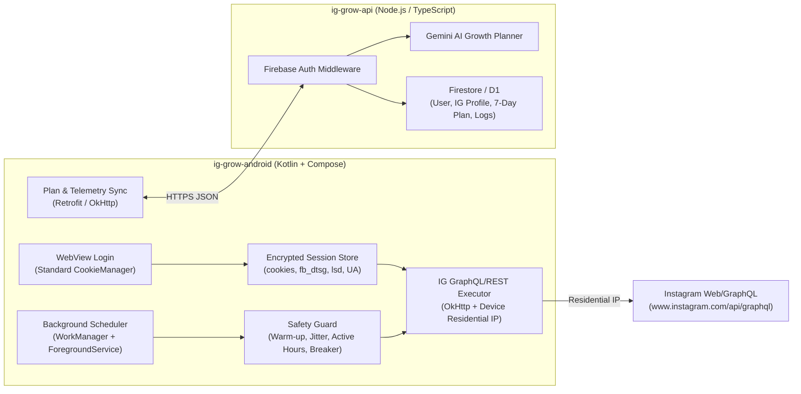

# 02 — System Architecture: `ig-grow-app`

## 1. High-Level Architecture

`ig-grow-app` consists of two decoupled components:
1. **`ig-grow-android` (Kotlin + Jetpack Compose)**: Handles WebView login, encrypted session persistence, background scheduling (`WorkManager` + `ForegroundService`), on-device safety enforcement, and direct Instagram GraphQL/REST execution over the phone's residential IP.
2. **`ig-grow-api` (Node.js + TypeScript)**: Lightweight Cloud AI & Planning backend (reusing Firebase Auth patterns from `Instant-Peer-APIs`) powered by the Gemini API and Firestore/D1.

> **Key Difference from `earn-share-mobile-app`**: `ig-grow-app` does **not** include the embedded Ktor HTTP server, reverse tunneling, or Redis scraper pool (`ig:sessions`), because the device is never exposed as a public scraping node.

---

## 2. Android Client (`ig-grow-android`)

### 2.1 Tech Stack
- **Language / UI**: Kotlin, Jetpack Compose, Material 3, Navigation Compose
- **Networking**: OkHttp (IG GraphQL calls + cookie/header injection), Retrofit (Cloud Backend sync)
- **Background Execution**: `WorkManager` (periodic sync & wakeup) + `ForegroundService` (active execution window with persistent notification)
- **Local Storage**: `EncryptedSharedPreferences` (session cookies & tokens) + Room DB (local action queue & execution history)

### 2.2 Session Capture & Refresh
- **Initial Login**: User logs in via `WebView` (`https://www.instagram.com/`).
- **Cookie Interception**: Standard `CookieManager.getInstance()` extracts `sessionid`, `csrftoken`, `ds_user_id`, `mid`, `ig_did`, `datr`, `rur`.
- **Dynamic Token Extraction**: A lightweight JS bridge / HTML meta-tag parser captures `fb_dtsg`, `lsd`, `jazoest`, `x-ig-app-id`, and `x-asbd-id` from the authenticated WebView session.
- **Silent Refresh**: If an API call returns an expired `fb_dtsg` / `csrftoken` error, a headless/background WebView load of `https://www.instagram.com/` refreshes the tokens without logging the user out.

### 2.3 Background Execution Loop
1. Once per day (or on plan activation), the app fetches the **Daily Action Batch** from `ig-grow-api`.
2. During the user's configured **Active Hours** (e.g., 09:00–22:00 local time), `ForegroundService` + `WorkManager` pops one task at a time from the local Room queue.
3. Before executing an engagement (e.g., Like or Follow), the executor optionally performs a **read-before-write** call (e.g., fetching the target's profile/posts) to mimic natural browsing.
4. After execution, a randomized human-like delay (jitter) is scheduled before the next action.
5. Execution outcomes (`success`, `rate_limited`, `challenge`, `skipped`) are batched and synced back to `ig-grow-api` for AI adaptation.

---

## 3. Cloud AI & Planning Backend (`ig-grow-api`)

### 3.1 Tech Stack
- **Runtime**: Node.js + TypeScript (Express or Hono), reusing Firebase Admin Auth patterns from `Instant-Peer-APIs`.
- **AI Engine**: Google Gemini API (`@google/genai`) with structured JSON output.
- **Database**: Cloud Firestore (or Cloudflare D1) storing:
  - `users/{uid}`: App user profile & preferences.
  - `ig_accounts/{ds_user_id}`: Account metadata, warm-up tier, safety state, goal & niche config.
  - `growth_plans/{planId}`: 7-day AI plan, daily quotas, approved comment templates.
  - `action_logs/{logId}`: Aggregated daily execution telemetry (no raw `sessionid` stored in cloud).

### 3.2 Core API Endpoints (Android ↔ Cloud)
- `POST /v1/account/register` — Register IG `ds_user_id`, public profile stats, niche, and goal.
- `POST /v1/plan/generate` — Trigger Gemini to generate a 7-day plan + comment templates.
- `POST /v1/plan/approve` — User approves/edits the plan and activates execution.
- `GET /v1/tasks/daily` — Fetch today's target discovery queries, action budgets, and comment templates.
- `POST /v1/telemetry/batch` — Report executed actions, follower delta, and any safety/error events.
